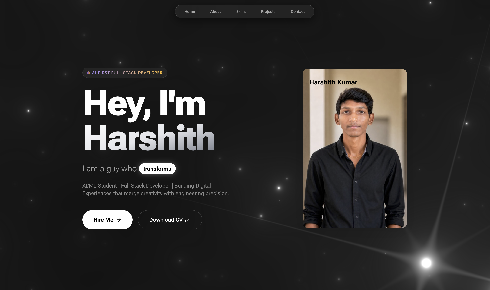
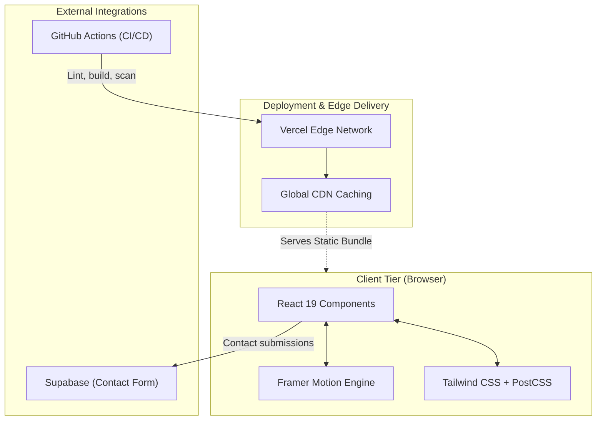

<div align="center">

# 👋 Welcome to Harshith Kumar's Portfolio



**Harshith Kumar Mannepalli** — AI Engineer & AI Researcher | Open Source Contributor

> The source for **Harshith Kumar's professional portfolio**, showcasing full stack and AI-powered engineering work, applied research, and open source contributions.

<p align="center">
  <a href="https://reactjs.org/"></a>
  <a href="https://tailwindcss.com/"></a>
  <a href="https://www.framer.com/motion/"></a>
  <a href="https://vitejs.dev/"></a>
  <a href="https://www.python.org/"></a>
  <a href="https://fastapi.tiangolo.com/"></a>
</p>

<h3>
  <a href="https://www.harshithkumar.in">🚀 View Live Portfolio</a>
  <span> · </span>
  <a href="https://www.linkedin.com/in/harshith-kumar-dev">💼 LinkedIn (Harshith Kumar)</a>
  <span> · </span>
  <a href="https://github.com/Harshithk951">🐙 GitHub (Harshithk951)</a>
  <span> · </span>
  <a href="mailto:mharshithkumar6@gmail.com">📧 Contact Harshith</a>
</h3>

</div>

---

## 🚀 Executive Summary


This repository houses the source code for **Harshith Kumar's high-performance, motion-driven portfolio**. It presents full stack and AI-powered engineering work alongside applied AI research — from LLM agents with rule-based safety layers to federated learning on edge devices.

It uses a **glassmorphic UI**, **bento-style grid layouts**, and a **macOS-style floating dock** for a premium, fluid experience.

---

## 🏗️ System Design & Architecture


The portfolio is a decoupled single-page frontend that prioritizes edge delivery and client-side rendering performance.



### Component Hierarchy
The UI is built on atomic design principles:
- **Core Layout**: `App.jsx` handles lazy loading, section order, and core state.
- **Sections**: `Hero`, `AboutBento`, `SkillsMarquee`, `ExperienceSection`, `ProjectsShowcase`, `ResearchSection`, `ServicesSection`, `CTASection`.
- **Primitives**: Reusable micro-components (dock, marquee, cards, toasts) styled with Tailwind and animated with Framer Motion presets.

---

## ✨ Premium Features


* 🎨 **Sophisticated UI**: Dark-themed glassmorphism built on custom CSS utility variables.
* ⚡ **Cinematic Animations**: Micro-interactions powered by Framer Motion with centralized presets and reduced-motion support.
* 📱 **Fluid Responsiveness**: Mobile-first grid systems scaling across all viewports.
* 🛠️ **Optimized Engineering**: Lazy loading, code splitting, and asset optimization for fast loads.
* ♿ **Inclusive Design**: ARIA labels, semantic sections, a skip link, and 44px touch targets.
* 🚀 **Smart Navigation**: A scroll-aware, macOS-style floating dock plus a tube-light navbar.

---

## 🛠️ Technical Ecosystem


### Core Technologies
| Layer | Tech Stack | Purpose |
| --- | --- | --- |
| **Frontend Framework** | React 19 | Component architecture & fast virtual DOM |
| **Styling Engine** | Tailwind CSS | Utility-first rapid styling and responsive design |
| **Animation Engine** | Framer Motion | Declarative physics-based animations |
| **Build Tooling** | Vite | Lightning-fast HMR and optimized production bundles |
| **Icons** | React Icons / Lucide | Lightweight, scalable vector icons |

---

## 📂 Project Structure

```bash
My-Portfolio/
├── public/                 # Static assets (images, CV, sitemap, service worker)
├── src/
│   ├── components/
│   │   ├── layout/         # Navbar, Footer, FloatingDock, MobileMenu, ScrollToTop
│   │   ├── sections/       # Hero, AboutBento, SkillsMarquee, ExperienceSection,
│   │   │                   # ProjectsShowcase, ResearchSection, ServicesSection, CTASection
│   │   ├── shared/         # ContactForm, SEOHead, Galaxy, LazyImage, ErrorBoundary
│   │   └── ui/             # Reusable primitives (marquee, cards, dock, toasts)
│   ├── hooks/              # useDeviceContext, useScrollDetection, useWordCycle
│   ├── lib/                # utils, analytics, animationConfig, supabase
│   ├── App.jsx             # Root composition & lazy loading
│   └── index.css           # Global tokens, reset, and custom animations
├── index.html              # Entry point & SEO metadata
└── vite.config.js          # Vite build configuration
```

---

## 🚦 Quick Start


### 1️⃣ Clone the Repository

```bash
git clone https://github.com/Harshithk951/My-Portfolio.git
cd My-Portfolio
```

### 2️⃣ Install Dependencies

```bash
npm install
```

### 3️⃣ Run the Development Server

```bash
npm run dev
```

Open `http://localhost:3000` in your browser.

---

## 📊 Performance Practices


Rather than quoting unmeasured scores, this project documents the practices it actually applies:

- **Lazy loading & code splitting**: below-the-fold sections load via `React.lazy` and Vite manual chunks.
- **Asset optimization**: pre-resized/multi-width hero imagery and preloaded critical fonts.
- **Animation discipline**: centralized Framer Motion presets and full `prefers-reduced-motion` handling.
- **Accessibility**: semantic sections, ARIA labels, a skip link, and mobile touch-target sizing.
- **SEO**: static head metadata, Open Graph/Twitter cards, JSON-LD structured data, `robots.txt`, and `sitemap.xml`.

---

## 👨‍💻 About Harshith Kumar

**Harshith Kumar Mannepalli** is an **AI Engineer & AI Researcher** — a Computer Science (AI & ML) student at Uttaranchal University, Dehradun (expected May 2027). He builds full stack and AI-powered applications with Python, TypeScript, React, Next.js, FastAPI and PostgreSQL, with containerized deployment experience across Docker, Kubernetes and CI/CD.

### 🎯 Expertise

- **AI & ML**: LLM APIs, AI Agents, Model Evaluation, Claude Code
- **Backend & Frontend**: FastAPI, Node.js, REST APIs, React.js, Next.js
- **Databases**: PostgreSQL, SQLite
- **DevOps & Cloud**: Docker, Kubernetes, Git/GitHub, Microsoft Azure, Microsoft Foundry
- **Languages**: Python, TypeScript
- **Testing & Quality**: unit testing, API testing, debugging, code review, performance optimization

### 🏆 Experience

- **Open Source Contributor**, Cal.com & freeCodeCamp (March 2026 – Present): 5 pull requests merged into production codebases after maintainer code review — core library logic, CI/CD workflows, automated validation, and accessibility fixes.

### 📄 Research

- Two IEEE conference papers (June 2026): federated continual learning with EWC for IoT edge devices, and AgriCogNet — an explainable ensemble for detecting cognitive fatigue in farm workers.

### 🏆 Notable Projects

- **RecoveryOS**: AI-driven revenue-recovery system with a rule-based safety layer; 232/232 unit tests and 36/36 validation checks passing.
- **Smart Sales Intelligence Agent**: modular 4-stage AI workflow with a real-time Next.js dashboard.
- **ResumeOptima**: AI-powered ATS resume analyzer.
- **Uni-Connect Hub**: student-alumni networking platform with role-based access for 200+ users.

### 🔗 Find Harshith Online

- **Portfolio**: [harshithkumar.in](https://harshithkumar.in) — Official portfolio website
- **LinkedIn**: [Harshith Kumar](https://www.linkedin.com/in/harshith-kumar-dev) — Professional profile
- **GitHub**: [Harshithk951](https://github.com/Harshithk951) — Open source contributions
- **Email**: mharshithkumar6@gmail.com

---

## 🤝 Connect With Harshith Kumar


<div align="center">

[](https://www.linkedin.com/in/harshith-kumar-dev/)
[](https://github.com/Harshithk951)
[](mailto:mharshithkumar6@gmail.com)

**Harshith Kumar Mannepalli**
_**AI Engineer & AI Researcher** — building safe, evaluated AI systems and shipping full stack products._

⭐ **If you like this project or find it helpful, please give it a star!** ⭐

</div>
